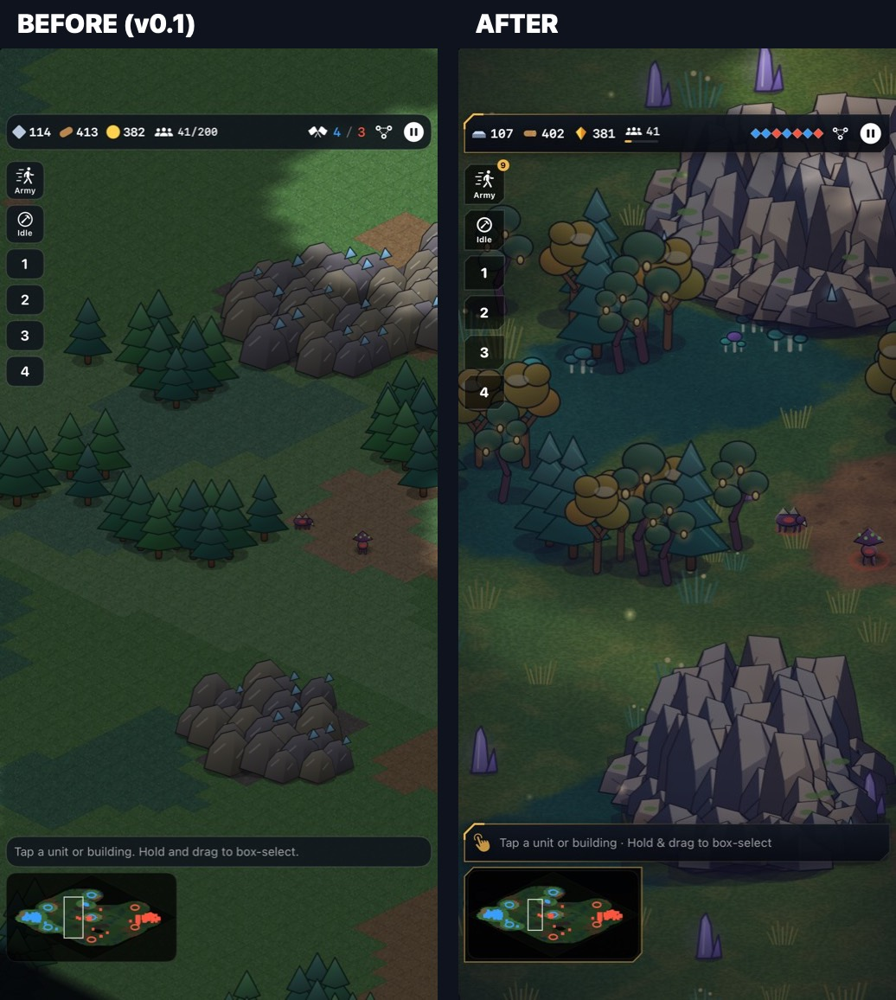

# Meridian: Three Fronts

An original isometric sci-fi real-time strategy game for iPhone (designed around the foldable **iPhone Duo**), built with Swift, SpriteKit and SwiftUI. Three factions: the Terran Concord, the Lattice and the Verdant Brood. 45 units, Iron/Gold/Wood economy, contested territory and a full computer opponent. Everything, including the art, is generated in code.



- Project status, test results and known issues: [STATUS.md](STATUS.md)
- Art direction: [docs/ART_DIRECTION.md](docs/ART_DIRECTION.md)
- Unit, building and upgrade reference: [docs/UNITS.md](docs/UNITS.md)

## Requirements

Xcode 27+ (iOS 17+ / macOS 14+ deployment). No third-party dependencies.

## Play

Open `Meridian.xcodeproj`, choose the **Meridian** scheme and an iPhone simulator (or *My Mac*), then Run.

From the command line:

```bash
xcodebuild -project Meridian.xcodeproj -scheme Meridian -configuration Release -destination 'platform=iOS Simulator,name=RTS Duo' -derivedDataPath build/dd CODE_SIGNING_ALLOWED=NO build
```

Observer modes: **Watch AI Match** and **Battle Lab 50/100/200** on the main menu, or `-battle <N>` (staged combined-arms battle, follow camera, spectator HUD). `tools/battle_capture.sh <dir> <N> [udid] [video-seconds]` captures a battle.

Development launch arguments: `-quality 0|1|2` (force effect tier), `-nozoom` (disable battle auto-zoom), `-autostart`, `-spectate` (AI plays both sides), `-warp <seconds>` (fast-forward), `-stress <units per side>` (renderer stress test, prints `PERF` lines), `-faction/-enemy humans|machines|aliens`, `-map crossroads|riverbend|highlands`, `-seed <n>`, `-zoom <scale>`, `-perf nosound,nofog,nohud` (performance isolation). `tools/capture.sh <dir>` captures the standard screenshot set, `tools/shot.sh` takes one quick capture, and `swift tools/compare.swift before after out` builds side-by-side comparisons. On macOS, `--art-sheet <file.png>` renders every unit and building to one image.

## Test

```bash
cd MeridianCore && swift test
```

```bash
xcodebuild -project Meridian.xcodeproj -scheme Meridian -destination 'platform=iOS Simulator,name=RTS Duo' -derivedDataPath build/dd CODE_SIGNING_ALLOWED=NO test
```

Headless harness (build with `swift build -c release` in `MeridianCore` first):

```bash
MeridianCore/.build/release/meridian-sim match --p0 humans --p1 aliens --map riverbend --seed 3
```

```bash
MeridianCore/.build/release/meridian-sim tournament --seeds 4
```

```bash
MeridianCore/.build/release/meridian-sim combat --counters
```

```bash
MeridianCore/.build/release/meridian-sim stress --units 200
```

## Balancing

Edit the JSON in `MeridianCore/Sources/MeridianCore/Data/`. Faction HP and build-time multipliers live in `factions.json` and are applied on load. Then rerun `tournament`/`combat`, and regenerate the reference with `python3 tools/gen_unit_docs.py`. `tools/rescale_costs.py` scales a faction's unit costs.
