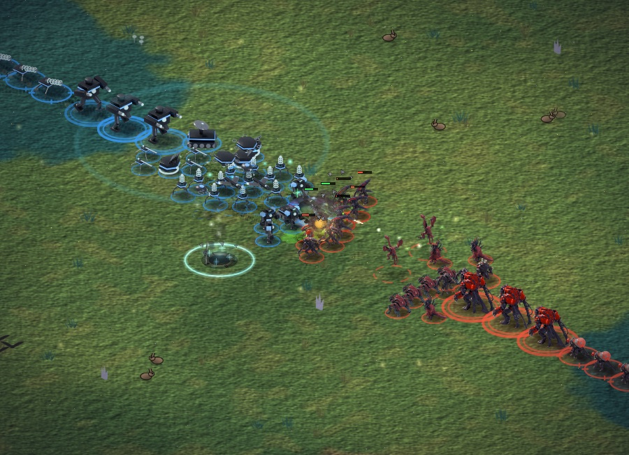
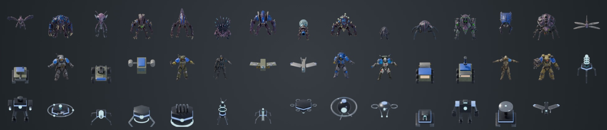
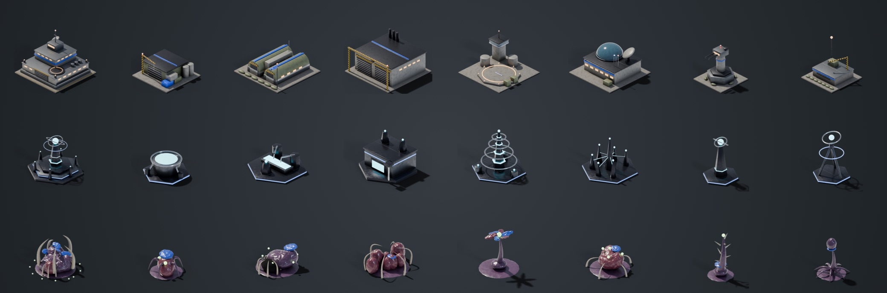

# Meridian: Three Fronts

An original isometric sci-fi real-time strategy game for iPhone and Mac, built with Swift, SpriteKit and SwiftUI. Three asymmetric factions fight over contested territory with a full economy, tech tree and computer opponent.



## Highlights

- **Three asymmetric factions:** the Terran Concord (military infantry and armour), the Lattice (hovering machines and energy weapons) and the Verdant Brood (organic swarm creatures). 44 units and 24 buildings.
- **Real-time strategy systems:** Iron, Gold and Wood economy; construction crews with diminishing returns; flow-field pathfinding and formations; contested strategic sites; fog of war; upgrades and a tech tree.
- **Computer opponent:** a strategic AI that scouts, expands, builds counters and attacks, with difficulty levels and a headless tournament harness used to balance the factions.
- **3D art pipeline:** characters modelled in Tripo, buildings and vehicles modelled procedurally in Blender Python, then all rendered into animated isometric sprites with 8 facings and team-colour masks. See [the art pipeline write-up](docs/ART_PIPELINE.md).
- **Built for touch:** tap to command, hold-then-drag to box-select, pinch to zoom, drag a building to the screen edge to scroll while placing.
- **Complete game loop:** Boot Camp tutorial, Quick Match (~10 minutes), save and resume, unit portraits with radio chatter, generated music and sound.
- **Tested simulation:** the game rules live in a platform-independent Swift package (`MeridianCore`) with unit tests, including a save/load round trip that proves a restored match plays on identically.

| | |
|---|---|
|  |  |

### Units

Rows: Verdant Brood, Terran Concord, Lattice.



### Buildings

Rows: Terran Concord, Lattice, Verdant Brood.



## Tech

| Area | What's used |
|---|---|
| Game | Swift, SpriteKit (rendering, custom terrain shader), SwiftUI (HUD and menus) |
| Simulation | `MeridianCore` Swift package: deterministic fixed-step world, pathfinding, combat, economy, AI, save games |
| Art | Tripo (AI 3D models), Blender 5 with Cycles, driven entirely by Python scripts in `tools/blender/` |
| Tooling | Headless simulator CLI (`meridian-sim`) for matches, tournaments and stress tests; capture scripts for screenshots |

About 20,000 lines of Swift and 1,800 lines of Python tooling.

More detail:
- Project status, test results and known issues: [STATUS.md](STATUS.md)
- Art direction: [docs/ART_DIRECTION.md](docs/ART_DIRECTION.md)
- Art pipeline: [docs/ART_PIPELINE.md](docs/ART_PIPELINE.md)
- Unit, building and upgrade reference: [docs/UNITS.md](docs/UNITS.md)

## Requirements

Xcode 27+ (iOS 17+ / macOS 14+ deployment). No third-party dependencies.

## Play

Open `Meridian.xcodeproj`, choose the **Meridian** scheme and an iPhone simulator (or *My Mac*), then Run.

From the command line:

```bash
xcodebuild -project Meridian.xcodeproj -scheme Meridian -configuration Release -destination 'platform=iOS Simulator,name=RTS Duo' -derivedDataPath build/dd CODE_SIGNING_ALLOWED=NO build
```

Tactical scenarios (headless metrics): `MeridianCore/.build/release/meridian-sim tactics [--only wall,corridor] [--disable kite,cohesion] [--debug]`. Run them in the app with `-scenario skirmish20|battle50|battle100|battle200|kite|wall|siege|corridor|airstrike`.

Observer modes: **Watch AI Match** and **Battle Lab 50/100/200** on the main menu, or `-battle <N>` (staged combined-arms battle, follow camera, spectator HUD). `tools/battle_capture.sh <dir> <N> [udid] [video-seconds]` captures a battle.

Development launch arguments: `-quality 0|1|2` (force effect tier), `-nozoom` (disable battle auto-zoom), `-autostart`, `-spectate` (AI plays both sides), `-warp <seconds>` (fast-forward), `-stress <units per side>` (renderer stress test, prints `PERF` lines), `-faction/-enemy humans|machines|aliens`, `-map crossroads|riverbend|highlands`, `-seed <n>`, `-zoom <scale>`, `-perf nosound,nofog,nohud` (performance isolation). `tools/capture.sh <dir>` captures the standard screenshot set, `tools/shot.sh` takes one quick capture, and `swift tools/compare.swift before after out` builds side-by-side comparisons. On macOS, `--art-sheet <file.png>` renders every unit and building to one image.

## Test

```bash
cd MeridianCore && swift test
```

```bash
xcodebuild -project Meridian.xcodeproj -scheme Meridian -destination 'platform=iOS Simulator,name=RTS Duo' -derivedDataPath build/dd CODE_SIGNING_ALLOWED=NO test
```

Headless harness (build with `swift build -c release` in `MeridianCore` first):

```bash
MeridianCore/.build/release/meridian-sim match --p0 humans --p1 aliens --map riverbend --seed 3
```

```bash
MeridianCore/.build/release/meridian-sim tournament --seeds 4
```

```bash
MeridianCore/.build/release/meridian-sim combat --counters
```

```bash
MeridianCore/.build/release/meridian-sim stress --units 200
```

## Balancing

Edit the JSON in `MeridianCore/Sources/MeridianCore/Data/`. Faction HP and build-time multipliers live in `factions.json` and are applied on load. Then rerun `tournament`/`combat`, and regenerate the reference with `python3 tools/gen_unit_docs.py`. `tools/rescale_costs.py` scales a faction's unit costs.
