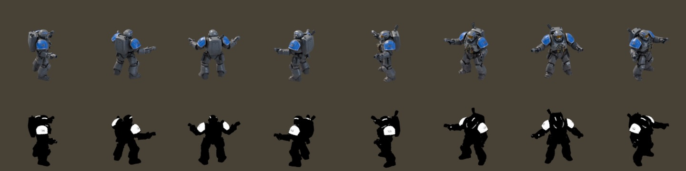

# Art pipeline: from 3D models to isometric sprites

Meridian is a 2D SpriteKit game, but every unit, building and prop is a 3D model rendered into sprites. The game gets the look of a 3D RTS while keeping 2D's low cost on a phone: thousands of sprites at 60 fps, with no 3D scene at runtime.



## Sources

| Asset | Source |
|---|---|
| Infantry and creatures (22 units) | Generated in [Tripo](https://www.tripo3d.ai) from text prompts ([prompts and guide](TRIPO_GUIDE.md)), exported as `.glb` |
| Vehicles, mechs and aircraft (22 units) | Modelled procedurally in Blender Python (`tools/blender/units_proc.py`) |
| Buildings (24) | Modelled procedurally in Blender Python (`tools/blender/buildings.py`), with a shared material kit per faction |
| Rocks, trees, ore, crystals and plants | Modelled procedurally in Blender Python (`tools/blender/props.py`) |

Nothing is placed by hand in the Blender UI. Every asset can be rebuilt from scripts with one command, so changing a camera angle or material re-renders the whole game consistently.

## Matching the game's camera

The game uses a 2:1 isometric projection: a tile is 64×32 points. The Blender camera is orthographic, 30° above the horizon and rotated 45°. Its scale is set so one world unit covers exactly 32√2 points, so screen-right points along world (1, 1). Buildings render onto the same canvas size the game uses for each footprint, so they drop into place with no hand-tuned offsets.

## Animation without a skeleton

Tripo models arrive as a single mesh with no rig. `tools/blender/unit_render.py` skins them procedurally with numpy:

1. **Find the body parts from the geometry.** Feet are the lowest vertices on each side, and hips sit at the median foot height. Arms are what sticks out sideways at shoulder height. Per-unit hints in `unit_fixes.json` cover models that need help, such as which way is forward or where the knee is.
2. **Assign weights.** Each vertex is weighted to a body part by position, with smooth falloff at joints. Leg weights stop at the hips so tails and cloaks don't tear.
3. **Pose it.** Each rig type has a simple procedural cycle:

| Rig | Used for | Motion |
|---|---|---|
| biped | infantry | swinging legs with bending knees, counter-swinging arms |
| multiped | insects and beasts | alternating leg pairs |
| flyer | winged creatures | wing beats with body bob |
| hover | floating units | sway and bob |
| vehicle | tanks and buggies | body pitch and bob |
| aircraft | planes and gunships | banking |

Each unit renders **8 facings × 6 poses**: idle, a 4-frame walk or wing cycle, and an attack. That's 48 frames per unit, 4,224 sprites across the roster.

## Team colours

Each sprite has a matching grayscale mask marking where team colour goes. The mask comes from either a material flag (procedural models) or a hue detector that finds the blue panels on Tripo models. Masks render with Blender's Raw view transform so their values stay linear. In game, SpriteKit multiplies the team colour through the mask, so one set of renders serves every player colour.

## Shadows and anchors

Buildings and props render over a shadow catcher, so their soft ground shadows are baked into the sprite. Props get a margin so shadows don't clip at the canvas edge. The game's sprite anchor accounts for the margin, so each object still sits on its tile.

## Running it

Blender runs headless with Cycles on Metal:

```bash
tools/render_units.sh h_breacher a_mantis   # listed units, one Blender process each (keeps memory flat)
/Applications/Blender.app/Contents/MacOS/Blender -b -P tools/blender/buildings.py
/Applications/Blender.app/Contents/MacOS/Blender -b -P tools/blender/props.py
```

Output goes straight into the app bundle folders (`Meridian/Units3D`, `Meridian/Buildings3D`, `Meridian/Props3D`). The Tripo `.glb` sources are kept out of git because of their size.
